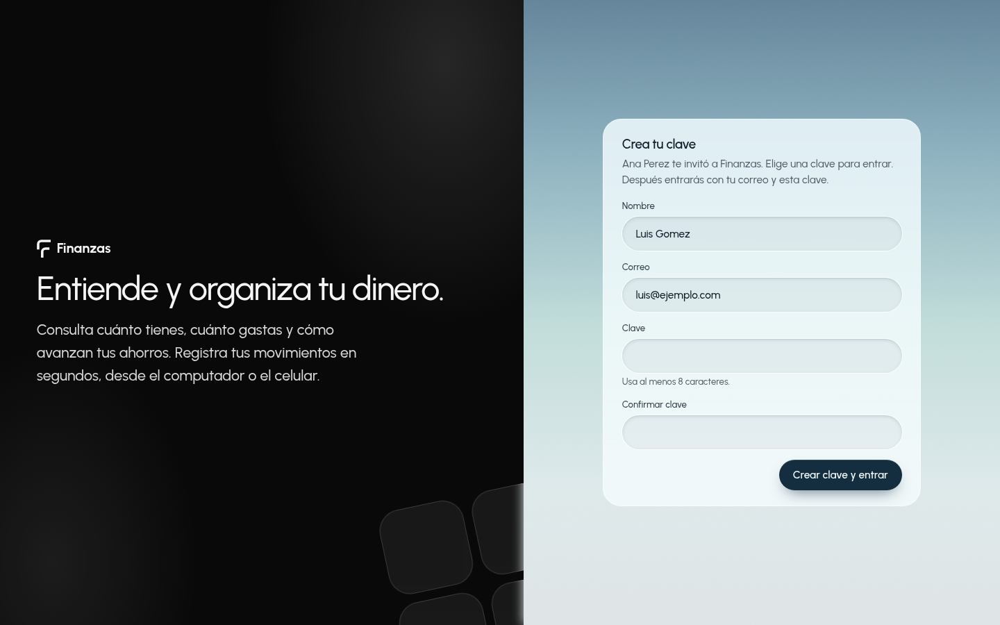
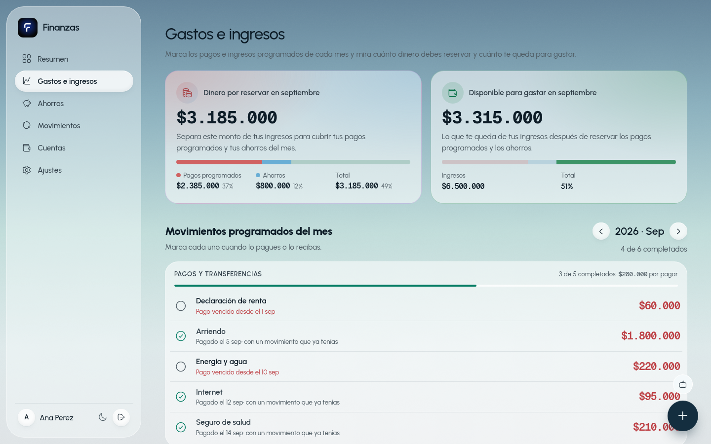
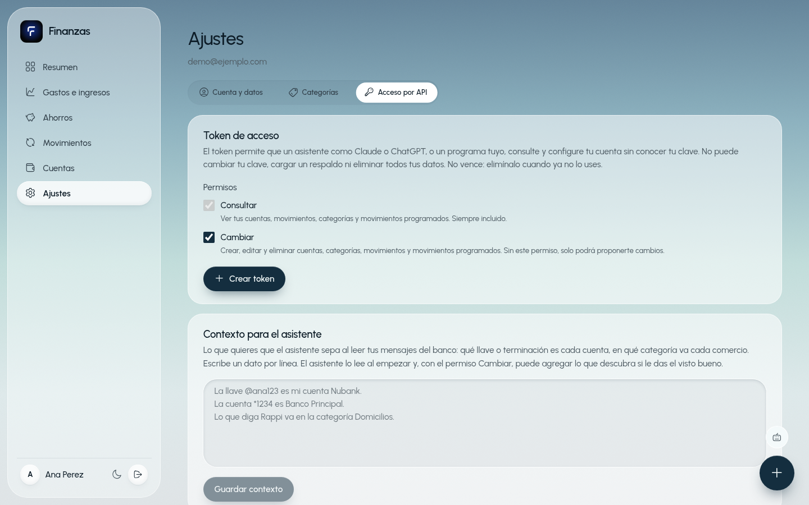
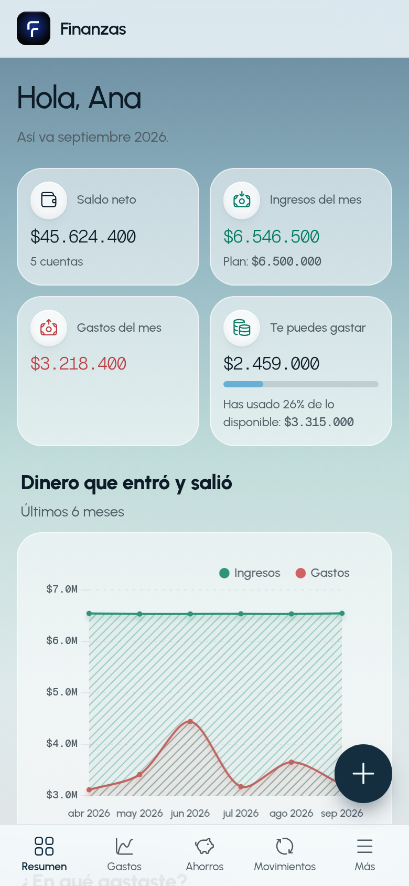
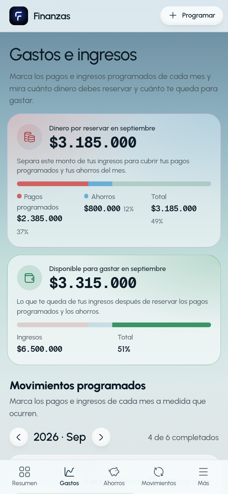
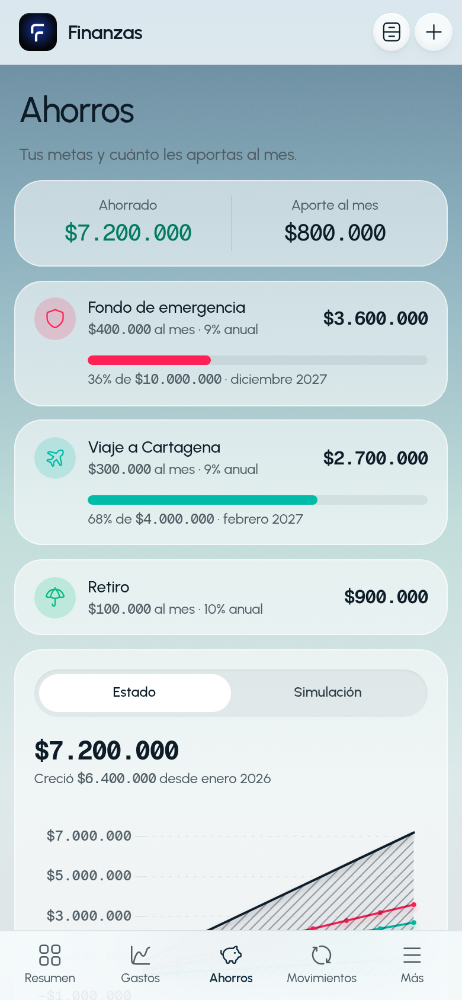
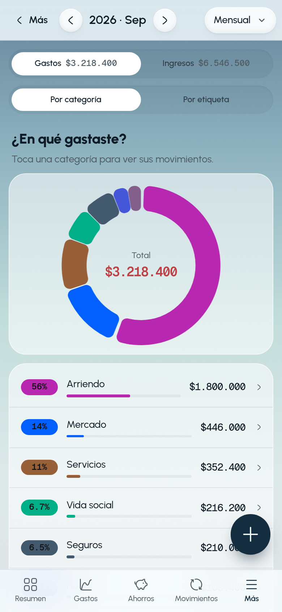
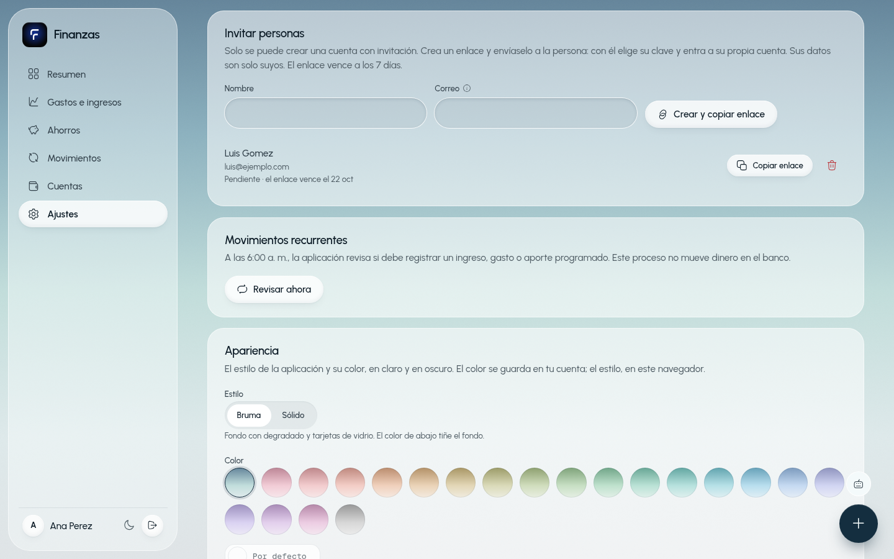

<p align="center">
  
</p>

<h1 align="center">
  <picture>
    <source media="(prefers-color-scheme: dark)" srcset="docs/marca/logotipo-oscuro.png">
    
  </picture>
</h1>

<p align="center"><b>Tu dinero, claro y en un solo lugar.</b></p>

Finanzas es una app web para llevar las cuentas de la casa: cuánto entra, cuánto sale, en qué se va y cuánto te queda para gastar este mes. Está pensada para Colombia (pesos colombianos), la puedes instalar en tu propio servidor y la pueden usar varias personas, cada una con sus datos.


> Los pantallazos usan datos inventados.

## Entrar

Cada persona entra con su correo y su clave, y solo ve sus propios datos. Las cuentas nuevas se crean **solo por invitación**: quien ya usa la app crea un enlace en *Ajustes → Cuenta y datos → Invitar personas* y se lo envía a la otra persona. Con ese enlace, la persona elige su clave y entra. El enlace sirve una sola vez y vence a los 7 días. En una instalación nueva, sin usuarios, la primera persona crea su cuenta desde la pantalla de entrada.

| En el computador | Con un enlace de invitación | En el celular |
|:---:|:---:|:---:|
|  |  |  |

## ¿Qué puedes hacer?

### Ver cómo vas este mes
El **Resumen** te muestra de un vistazo tu **saldo neto** (lo que tienes menos lo que debes), **cuánto puedes gastar** todavía este mes y cuánto llevas ahorrado. Debajo está el análisis del mes.

### Entender en qué se va tu plata
En el análisis, dentro del **Resumen**, comparas ingresos y gastos por semana, mes o año, y los filtras por etiqueta o por cuenta. Un bloque «En pocas palabras» resume lo importante: cuánto te quedó libre, si gastas más o menos que el mes pasado y qué categoría se llevó más. También ves el ritmo de gasto frente al mes anterior y el reparto por categoría, con un presupuesto para cada una.


### Anotar tus movimientos
Registra **ingresos, gastos y transferencias** entre cuentas. A cada movimiento le puedes poner categoría, notas, etiquetas y hasta **adjuntar la foto de la factura** o un PDF. Puedes buscar por texto o por monto y filtrar por cuenta, categoría, tipo o etiqueta. Los movimientos se ven como lista, calendario, mes a mes o en total. Con clic derecho seleccionas varios y ves cuánto suman.

Al hacer clic en un monto, la app **copia solo los dígitos**, listos para pegar en la app de tu banco. En el celular, deja el dedo sobre el monto hasta que vibre.


### Tener todas tus cuentas juntas
Banco, efectivo, billeteras digitales, inversiones… Cada cuenta muestra su saldo, cuánto tiene **reservado** para tus ahorros y cuánto queda **disponible**. Las **tarjetas de crédito** van aparte, con su cupo, lo que debes y lo que te queda.


### Gastos e ingresos
En **Gastos e ingresos** programas tus ingresos (el sueldo) y tus pagos habituales (arriendo, servicios, seguros), y los marcas a medida que ocurren. Arriba, dos tarjetas responden lo importante del mes:

- **Dinero por reservar**: tus pagos programados, tus ahorros y lo que debes en tarjetas de crédito.
- **Disponible para gastar**: lo que te queda de tus ingresos después de reservar todo eso.

> **Ingresos − pagos programados − ahorros − tarjetas de crédito = lo que puedes gastar**

Un movimiento programado puede repetirse cada mes, cada año o pasar una sola vez. Para un pago anual (el seguro, el impuesto del carro) la app te dice cuánto **reservar** cada mes para tenerlo listo. Con el **registro automático**, la app crea el movimiento en su fecha; no hace operaciones en tu banco. Al marcar un pago como hecho, si ya lo habías registrado, la app te propone usar ese movimiento en vez de crear otro.



### Ahorrar con metas
Crea ahorros con **meta, aporte mensual y rentabilidad**. La app calcula cuándo llegas a la meta y tiene un **simulador** para ver cómo crecería tu ahorro. Un ahorro se puede repartir entre varias cuentas y **compartir con otra persona** (por ejemplo, un viaje en pareja): cada quien pone su propio aporte al mes y el del ahorro es la suma de todos. Los aportes pueden ser automáticos.


### Registrar con un asistente
Además de anotarlos a mano, puedes pedirle a un asistente (Claude, ChatGPT…) que registre tus movimientos por ti: le cuentas «ayer gasté $45.900 en el mercado con la tarjeta» y lo anota. Se conecta con el token de *Ajustes → Acceso por API*. Si le das acceso a tu Gmail, el asistente puede buscar ahí los avisos de tus bancos y registrarlos; la app recuerda qué correos ya revisó, para que ningún asistente registre dos veces el mismo. La app no lee tu correo ni se conecta a tu banco: todo lo que está en ella lo registraste tú o tu asistente.

En el token eliges si el asistente solo consulta o también puede cambiar. Es uno solo, no vence y lo puedes volver a ver cuando quieras; copias unas instrucciones listas para pegar en el asistente. El asistente lee la guía en `/api/finanzas/guia` (colecciones, rutas y pasos, generada desde el servidor) y conoce tus movimientos programados: cuáles tocan cada mes, cuáles están vencidos y cuáles ya se pagaron. Antes de marcar un pago puede simularlo (`dry_run`) y mostrarte qué cambiaría.

Debajo del token hay un **contexto para el asistente**: un texto donde anotas, por ejemplo, qué llave o terminación es cada cuenta y en qué categoría va cada comercio. El asistente lo lee al empezar y, con tu visto bueno, le agrega lo que descubra. Ningún token puede cambiar tu clave, invitar personas, cargar un respaldo ni borrar todos tus datos.



### En el celular
La app **se instala en el celular** como una aplicación más (desde el navegador: *Agregar a pantalla de inicio*) y tiene una versión hecha para el teléfono, con las mismas secciones y el mismo aspecto que la del computador. Abajo están **Resumen, Gastos e ingresos, Ahorros, Movimientos y Más** (Cuentas, Análisis y Ajustes). En Movimientos ves el mes de cuatro maneras:

- **Diario**: tus movimientos día por día, con lo que entró y salió cada día.
- **Calendario**: el mes completo, con el gasto de cada día a la vista.
- **Mensual**: el año mes a mes y semana a semana.
- **Total**: cómo vas con tu presupuesto libre, tus gastos fijos y cada cuenta.

Para **anotar en segundos**, toca el **+**, escribe el monto, elige categoría y cuenta, y listo.

Además **funciona sin internet**: lo que anotes sin señal se guarda en el teléfono y se envía solo cuando vuelve la conexión.

| Resumen | Diario | Calendario | Mensual |
|:---:|:---:|:---:|:---:|
|  |  |  |  |
| **Total** | **Gastos e ingresos** | **Ahorros** | **Análisis** |
|  |  |  |  |
| **Cuentas** | **Anotar un gasto** | **Modo oscuro** | |
|  |  |  | |

### Y además…
- **Modo claro y oscuro**, un color de fondo a tu gusto y un estilo sólido (sin degradados) para quien prefiere colores planos.
- **Varios usuarios**, por invitación: cada persona tiene sus propios datos. La clave se cambia en *Ajustes → Cuenta y datos*.
- **Respaldo de tus datos**: exporta todo a un archivo y vuelve a cargarlo cuando quieras, incluso en otro servidor.
- **Respaldos automáticos del servidor**: dos veces al día (a medianoche y a mediodía, hora de Colombia) se guarda una copia de toda la base de datos. Se conservan las últimas 30.
- **Atajos de teclado** en el computador: `N` agrega un movimiento y `?` muestra todos los atajos.


| Ajustes | Invitar personas |
|:---:|:---:|
|  |  |

---

## Instalar en un servidor (con Docker)

Es la forma recomendada. Todo corre en **un solo contenedor**: la base de datos, la API y la página web.

### Qué necesitas

- Un servidor o computador con **Linux de 64 bits (x86_64/amd64)** y **Docker** con Docker Compose.
- Pocos recursos: es un solo programa liviano. El disco crece con tus movimientos y adjuntos.
- Opcional: un **dominio con HTTPS** (por ejemplo detrás de Nginx Proxy Manager, Caddy o Traefik). Es necesario para instalarla en el celular.

### Paso a paso

1. **Descarga el código y construye la imagen**

   ```bash
   git clone <url-de-este-repositorio> finanzas
   ```

   ```bash
   cd finanzas && docker build -t plane-finanzas:latest .
   ```

2. **Prepara una carpeta para la app** (ahí quedan tus datos)

   ```bash
   mkdir -p /opt/finanzas/pb_data && cp deploy/docker-compose.yml /opt/finanzas/
   ```

3. **Arranca**

   ```bash
   cd /opt/finanzas && docker compose up -d
   ```

   La app queda en el puerto **3434**. Ábrela en el navegador y crea la primera cuenta. Después, invita a otras personas desde *Ajustes → Cuenta y datos → Invitar personas*.

   Para que escuche solo en el servidor (detrás de un proxy con HTTPS), crea un archivo `.env` junto al `docker-compose.yml` con `PUERTO=127.0.0.1:3434`. La app no necesita otras variables.

4. **(Opcional) Crea el administrador** del panel de la base de datos (`/_/`):

   ```bash
   docker exec plane-finanzas /pb/pocketbase superuser upsert admin@correo.com una-clave-larga --dir /pb/pb_data
   ```

### Actualizar

Descarga los cambios, vuelve a construir la imagen y reinicia. Tus datos (`pb_data`) no se tocan.

```bash
git pull && docker build -t plane-finanzas:latest .
```

```bash
cd /opt/finanzas && docker compose up -d
```

> Si construyes en tu computador y el servidor es otro, puedes enviarle la imagen con
> `docker save plane-finanzas:latest | gzip | ssh usuario@servidor "gunzip | docker load"`.

### Copias de seguridad

La app guarda una copia de toda la base de datos dos veces al día, a las 5:00 y a las 17:00 UTC (medianoche y mediodía en Colombia), en `/opt/finanzas/pb_data/backups`. Conserva las últimas 30. Puedes cambiarlo o descargar una copia en el panel `/_/` → *Settings → Backups*.

Esas copias quedan en el mismo servidor: cópialas a otro lugar de vez en cuando. Cada usuario también puede exportar sus datos desde **Ajustes → Cuenta y datos → Exportar**.

---

## Para desarrolladores

Hecha con **Svelte 5** + **PocketBase** (base de datos, usuarios y API en un solo binario) + **Chart.js**.

### Requisitos

- [Bun](https://bun.sh) 1.x
- Linux o macOS (el script descarga PocketBase para tu sistema)

### Arrancar en local

```bash
bun install
```

```bash
bun run dev
```

Eso levanta la API en `:8093` y la web en http://localhost:3434 (descarga PocketBase si falta).

Para cambiar los puertos, copia `.env.example` a `.env` y ajústalo.

Datos de ejemplo desde un CSV del registro contable (se puede correr varias veces sin duplicar). Crea el usuario solo si la base no tiene ninguno; si ya hay cuentas, usa una que exista:

```bash
bun run seed -- --email demo@ejemplo.com --password "clave-larga" --name "Ana Perez"
```

### Comandos

| Comando | Qué hace |
|---|---|
| `bun run dev` | PocketBase + Vite en una sola terminal |
| `bun run pb` / `bun run web` | Solo la API / solo la web |
| `bun run pb:admin correo clave` | Crea el administrador del panel `/_/` |
| `bun run test` | Tests de los cálculos, la proyección y los tokens |
| `bun run check` | Revisión de tipos (svelte-check) |
| `bun run build` | Compila la web a `pocketbase/pb_public` (PocketBase la sirve) |

### Estructura

```
pocketbase/
  pb_migrations/   esquema (colecciones + reglas por usuario)
  pb_hooks/        programados, respaldo, invitaciones, tokens de API, tareas automáticas
src/
  routes/          Resumen (con el análisis), Movimientos, Cuentas, Ahorros, Gastos e ingresos, Ajustes, vista móvil
  components/app/  piezas de la app (formularios, tarjetas, listas)
  components/ui/   componentes base
  lib/finance.ts   cálculos: plan, ahorros, simulación, estados
  lib/outbox.ts    cola de cambios sin conexión
deploy/            docker-compose.yml de producción
docs/marca/        logo (SVG) y logotipo (claro y oscuro)
docs/capturas/     pantallazos del README
Dockerfile         imagen de producción (un solo proceso)
```

## Licencia

MIT. Ver [LICENSE](LICENSE).
