<p align="center">
  
</p>

<h1 align="center">
  <picture>
    <source media="(prefers-color-scheme: dark)" srcset="docs/marca/logotipo-oscuro.png">
    
  </picture>
</h1>

<p align="center"><b>Tu dinero, claro y en un solo lugar.</b></p>

Finanzas es una app web para llevar las cuentas de la casa: cuánto entra, cuánto sale, en qué se va y cuánto te queda para gastar este mes. Está pensada para Colombia (pesos colombianos), la puedes instalar en tu propio servidor y la pueden usar varias personas, cada una con sus datos.

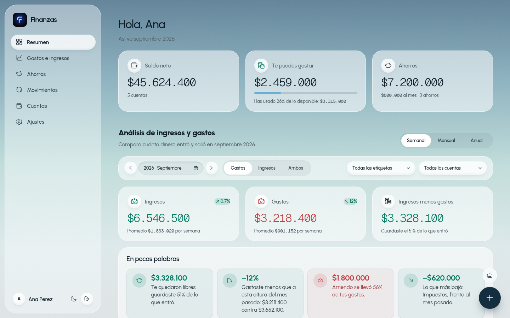

> Los pantallazos usan datos inventados.

## Entrar

Cada persona crea su cuenta con su correo y una clave, y solo ve sus propios datos. La pantalla de entrada se adapta al computador y al celular.

| En el computador | En el celular |
|:---:|:---:|
| 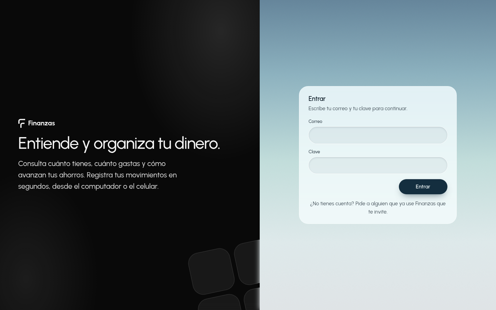 | 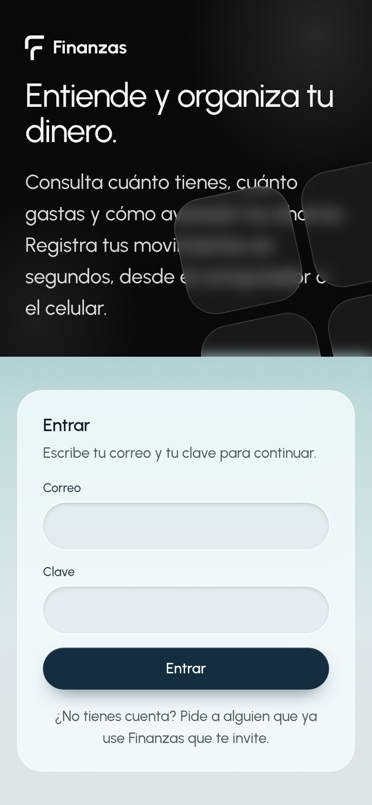 |

## ¿Qué puedes hacer?

### Ver cómo vas este mes
El **Resumen** te muestra de un vistazo cuánto dinero tienes en total, cuánto entró y salió este mes y, lo más importante, **cuánto te queda libre para gastar** (o cuánto te pasaste). También verás en qué se te fue la plata y cómo van tus ahorros.

### Anotar tus movimientos
Registra **ingresos, gastos y transferencias** entre cuentas. A cada movimiento le puedes poner categoría, notas, etiquetas y hasta **adjuntar la foto de la factura** o un PDF. Puedes buscar y filtrar por cuenta, categoría o tipo.

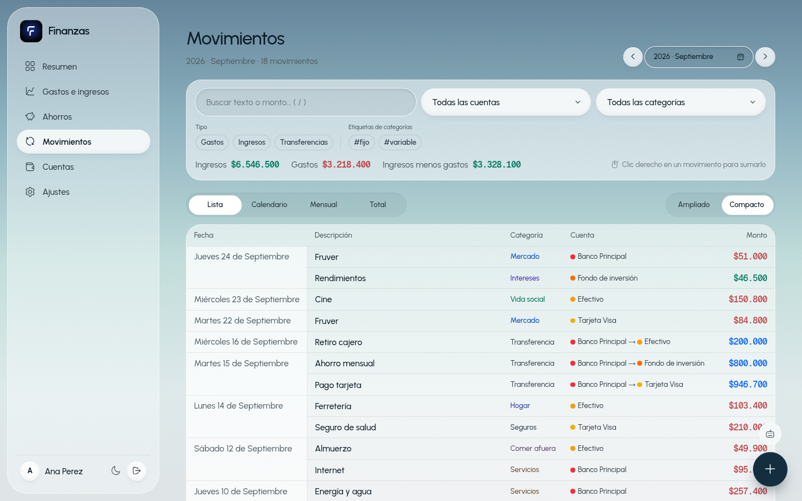

### Tener todas tus cuentas juntas
Banco, tarjeta de crédito, efectivo, billeteras digitales, inversiones… Cada cuenta muestra su saldo y su color. Ves cuánto tienes en total, cuánto está apartado para ahorros y cuánto debes.

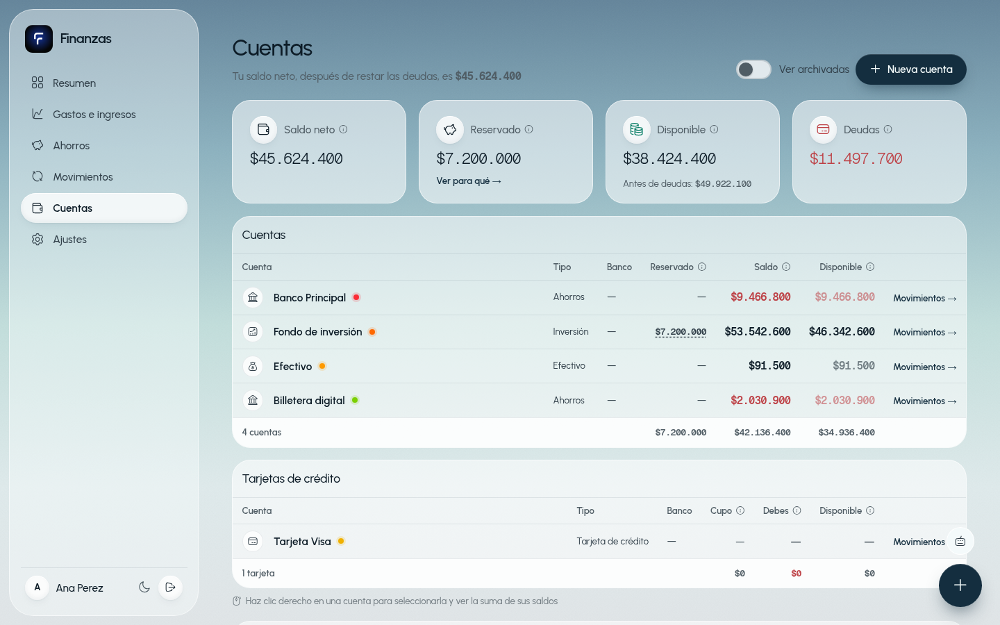

### Registrar con un asistente
Además de anotarlos a mano, puedes pedirle a un asistente (Claude, ChatGPT…) que registre tus movimientos por ti: le cuentas «ayer gasté $45.900 en el mercado con la tarjeta» y lo anota. Se conecta con el token de *Ajustes → Acceso por API* (ver «Y además…»). La app no lee tu correo ni se conecta a tu banco: todo lo que está en ella lo registraste tú o tu asistente.

### Entender en qué se va tu plata
Debajo del **Resumen**, en el análisis, comparas ingresos y gastos por semana, mes o año, y ves el reparto por categoría con un presupuesto para cada una.

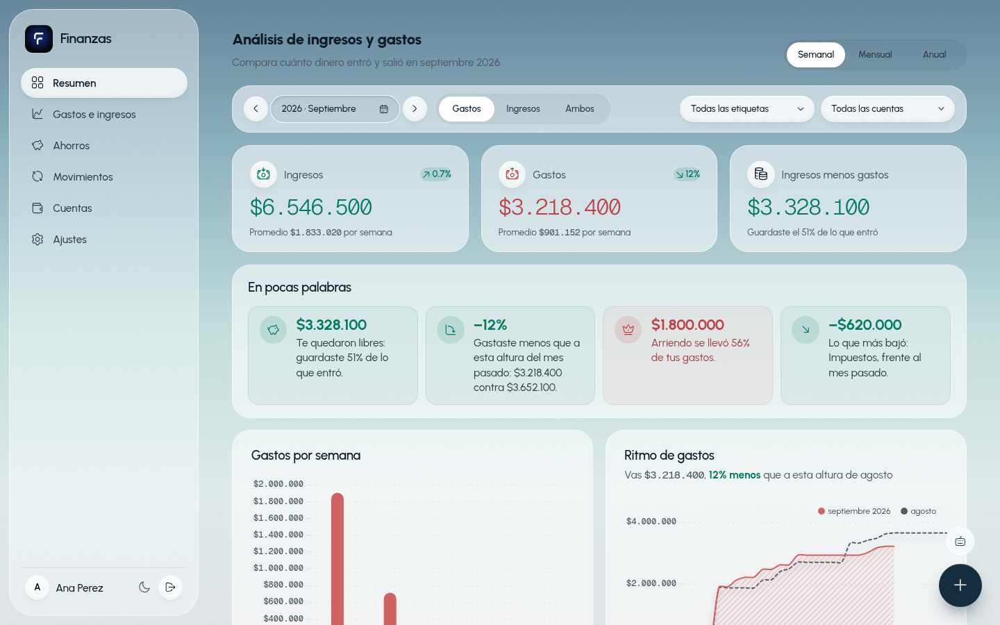

### Ahorrar con metas
Crea ahorros con **meta, aporte mensual y rentabilidad**. La app calcula para cuándo llegas a la meta. Un ahorro se puede repartir entre varias cuentas y **compartir con otra persona** (por ejemplo, un viaje en pareja): cada quien pone su propio aporte al mes y el del ahorro es la suma de todos. Los aportes pueden ser automáticos.

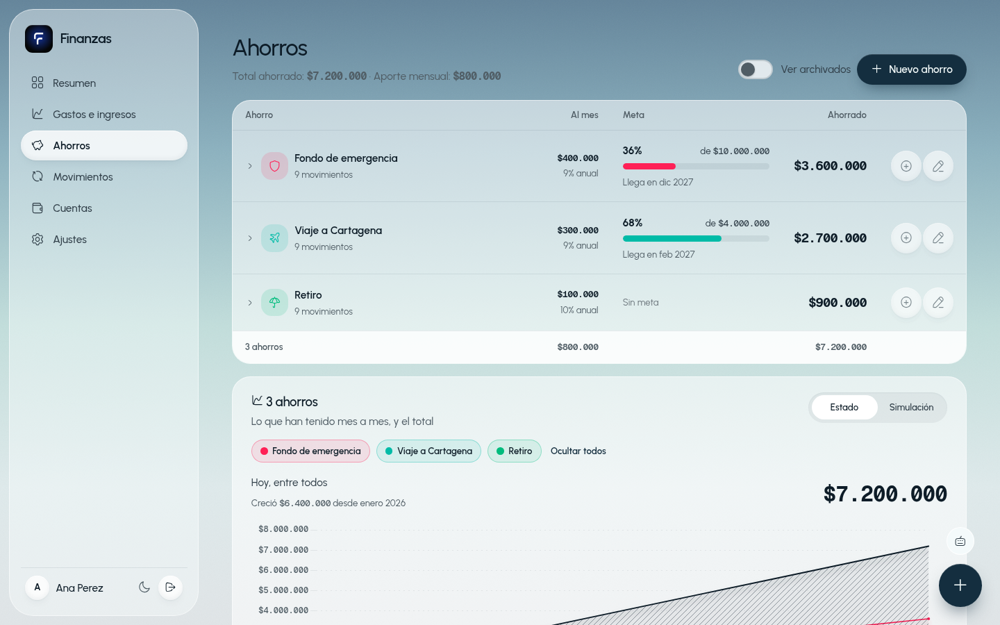

### Gastos e ingresos
En **Gastos e ingresos** programas tus ingresos (sueldo) y tus pagos de cada mes (arriendo, servicios, seguros), y los marcas a medida que ocurren. Arriba, dos tarjetas responden lo importante del mes:

- **Dinero por reservar**: tus pagos programados, tus ahorros y lo que debes en tarjetas de crédito (lo gastado este mes y lo que viene de meses anteriores).
- **Disponible para gastar**: lo que te queda de tus ingresos después de reservar todo eso.

> **Ingresos − pagos programados − ahorros − tarjetas de crédito = lo que puedes gastar**

En **Cuentas**, las tarjetas de crédito van aparte, con su cupo, lo que debes y lo que te queda disponible.

Además proyecta los próximos 12 meses, tiene un **simulador** y responde preguntas como "¿para cuándo tendría $10.000.000?". Los fijos que marques se crean solos cada mes. Al marcar un pago como hecho, si ya está registrado, la app te propone usar ese movimiento en vez de crear otro.

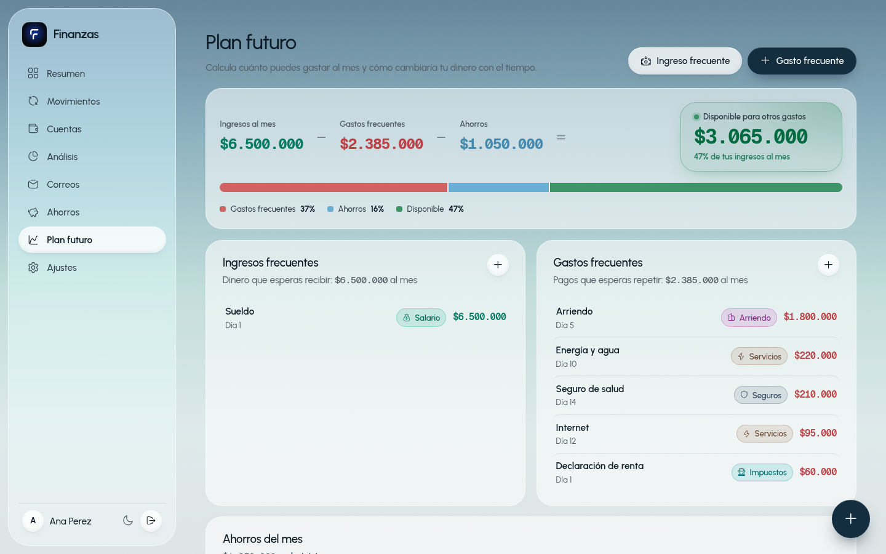

### En el celular
La app **se instala en el celular** como una aplicación más (desde el navegador: *Agregar a pantalla de inicio*) y tiene una versión hecha para el teléfono, con las mismas secciones y el mismo aspecto que la del computador: abajo **Resumen, Movimientos, Cuentas, Análisis y Más** (Ahorros, Gastos e ingresos y Ajustes). En Movimientos:

- **Diario**: tus movimientos día por día, con lo que entró y salió cada día.
- **Calendario**: el mes completo, con el gasto de cada día a la vista.
- **Mensual**: el año mes a mes y semana a semana.
- **Total**: cómo vas con tu presupuesto libre, tus gastos fijos y cada cuenta.
- **Estadísticas**: en qué se fue la plata, en porcentajes.
- **Cuentas**: lo que tienes, lo que debes y el balance.
- **Anotar en segundos**: toca el **+**, escribe el valor, elige categoría y cuenta, y listo.

Además **funciona sin internet**: lo que anotes sin señal se guarda en el teléfono y se envía solo cuando vuelve la conexión.

| Diario | Calendario | Mensual | Total |
|:---:|:---:|:---:|:---:|
| 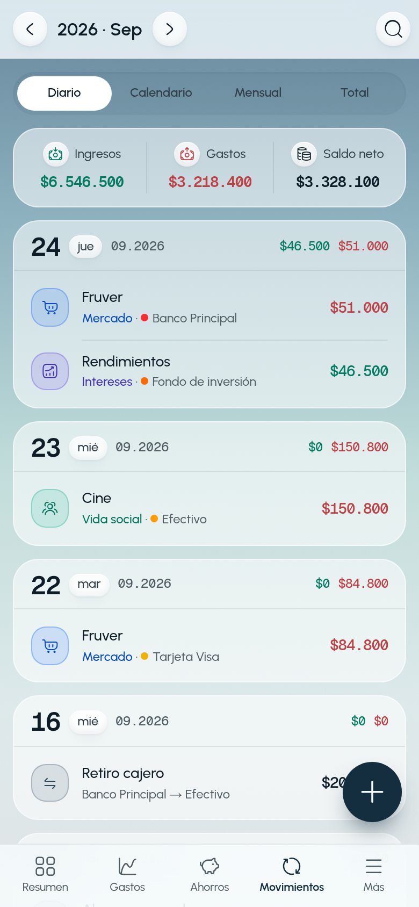 | 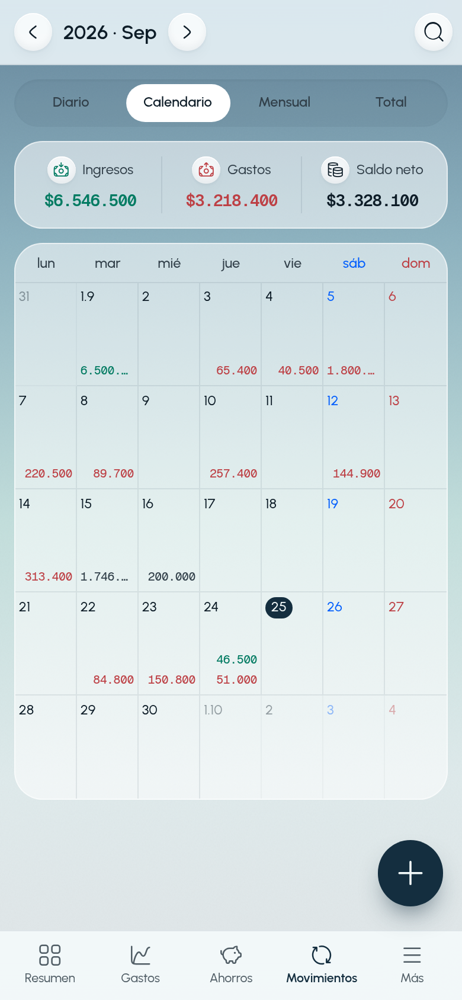 | 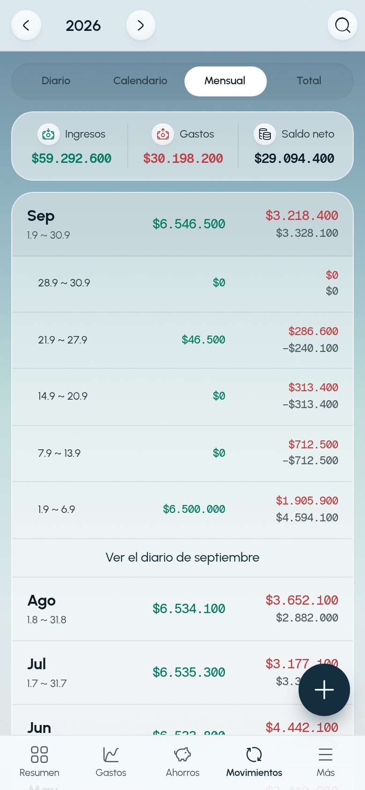 | 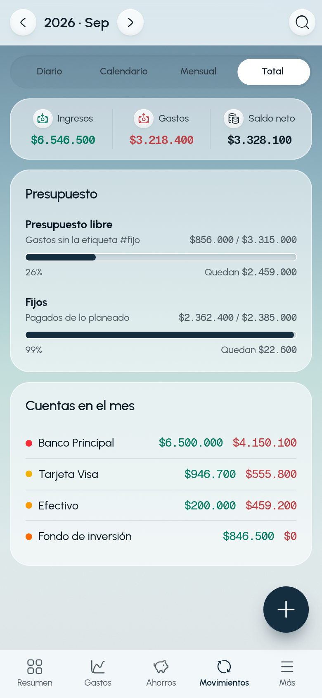 |
| **Estadísticas** | **Cuentas** | **Anotar un gasto** | **Modo oscuro** |
| 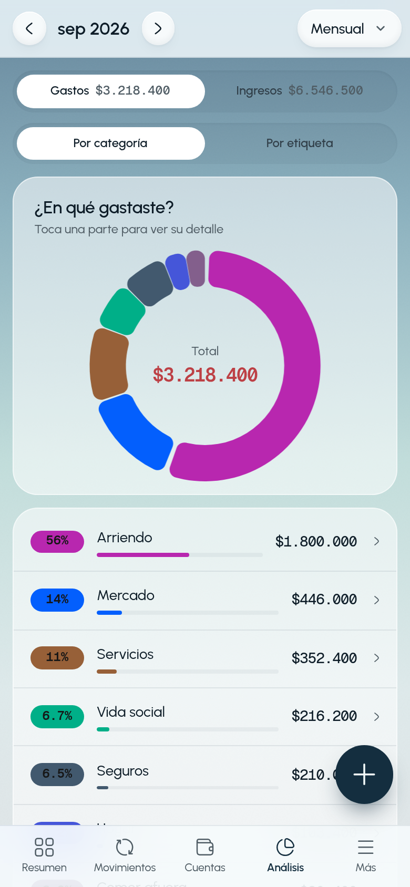 | 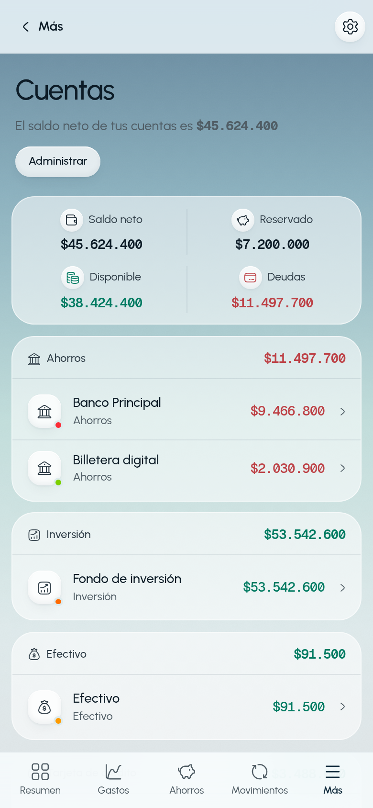 | 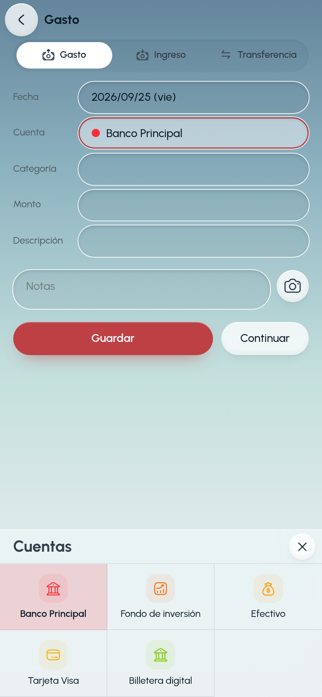 | 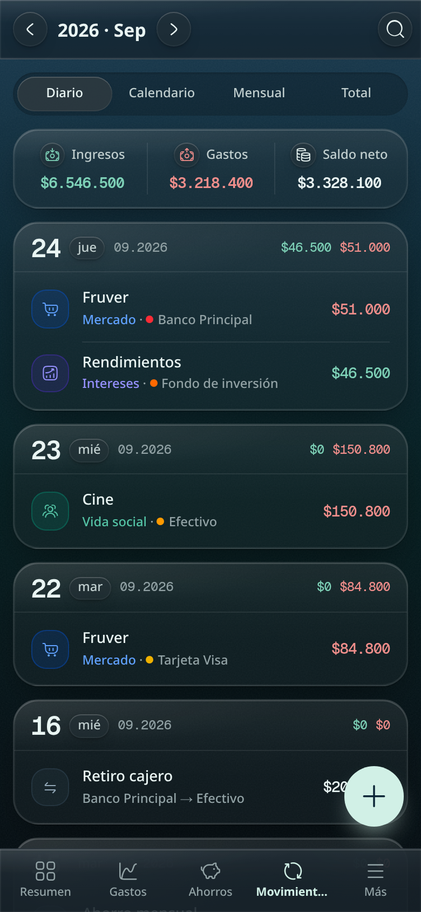 |

### Y además…
- **Modo claro y oscuro**, y un estilo sólido (sin degradados) para quien prefiere colores planos.
- **Respaldo**: exporta todos tus datos a un archivo y vuelve a cargarlos cuando quieras, incluso en otro servidor.
- **Varios usuarios**: cada persona se registra con su correo y solo ve sus datos. La clave se cambia en *Ajustes → Cuenta y datos*.
- **Acceso por API para asistentes**: en *Ajustes → Acceso por API* creas tu token (solo consultar, o consultar y cambiar). Es uno solo, no vence y lo puedes volver a ver cuando quieras; copias unas instrucciones listas para pegar en Claude, ChatGPT u otro asistente. El asistente lee la guía en `/api/finanzas/guia` —colecciones, rutas y pasos, generada desde el servidor— y puede, por ejemplo, registrar los movimientos que le cuentes. También conoce la proyección: qué pagos programados tocan cada mes, cuáles están vencidos y cuáles ya se pagaron, y puede marcarlos. Antes de marcar un pago, el asistente puede simularlo (`dry_run`) y mostrarte qué cambiaría. Ningún token puede cambiar tu clave, cargar un respaldo ni borrar todos tus datos.

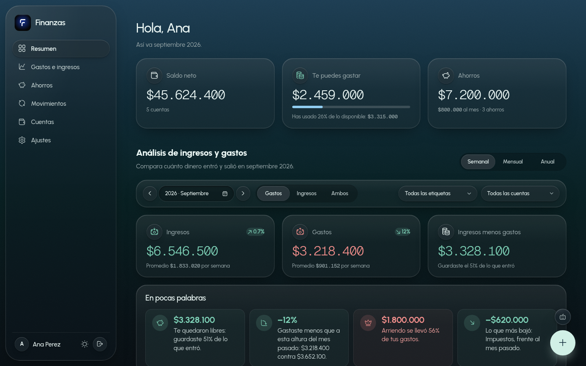

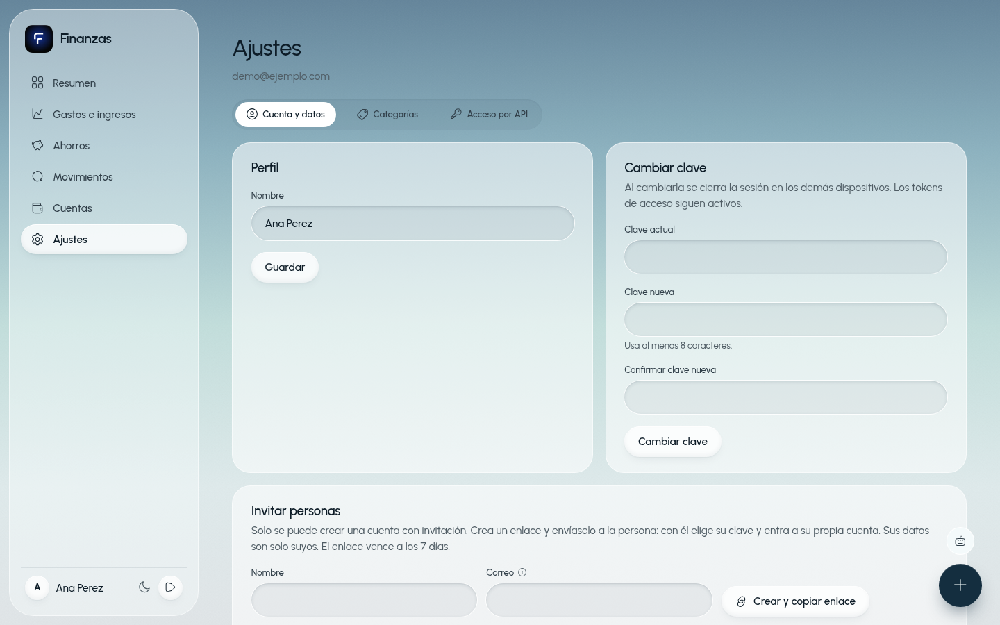

---

## Instalar en un servidor (con Docker)

Es la forma recomendada. Todo corre en **un solo contenedor**: la base de datos, la API y la página web.

### Qué necesitas

- Un servidor o computador con **Linux de 64 bits (x86_64/amd64)** y **Docker** con Docker Compose.
- Pocos recursos: es un solo programa liviano. El disco crece con tus movimientos y adjuntos.
- Opcional: un **dominio con HTTPS** (por ejemplo detrás de Nginx Proxy Manager, Caddy o Traefik). Es necesario para instalarla en el celular.

### Paso a paso

1. **Descarga el código y construye la imagen**

   ```bash
   git clone <url-de-este-repositorio> finanzas
   ```

   ```bash
   cd finanzas && docker build -t plane-finanzas:latest .
   ```

2. **Prepara una carpeta para la app** (ahí quedan tus datos)

   ```bash
   mkdir -p /opt/finanzas/pb_data && cp deploy/docker-compose.yml /opt/finanzas/
   ```

3. **Arranca**

   ```bash
   cd /opt/finanzas && docker compose up -d
   ```

   La app queda en el puerto **3434**. Ábrela en el navegador, toca **Crear cuenta** y listo.

4. **(Opcional) Crea el administrador** del panel de la base de datos (`/_/`):

   ```bash
   docker exec plane-finanzas /pb/pocketbase superuser upsert admin@correo.com una-clave-larga --dir /pb/pb_data
   ```

### Actualizar

Descarga los cambios, vuelve a construir la imagen y reinicia. Tus datos (`pb_data`) no se tocan.

```bash
git pull && docker build -t plane-finanzas:latest .
```

```bash
cd /opt/finanzas && docker compose up -d
```

> Si construyes en tu computador y el servidor es otro, puedes enviarle la imagen con
> `docker save plane-finanzas:latest | gzip | ssh usuario@servidor "gunzip | docker load"`.

### Copias de seguridad

Todo lo importante está en la carpeta `/opt/finanzas/pb_data`. Cópiala de vez en cuando. Cada usuario también puede exportar sus datos desde **Ajustes → Cuenta y datos → Exportar**.

---

## Para desarrolladores

Hecha con **Svelte 5** + **PocketBase** (base de datos, usuarios y API en un solo binario) + **Chart.js**.

### Requisitos

- [Bun](https://bun.sh) 1.x
- Linux o macOS (el script descarga PocketBase para tu sistema)

### Arrancar en local

```bash
bun install
```

```bash
bun run dev
```

Eso levanta la API en `:8093` y la web en http://localhost:3434 (descarga PocketBase si falta).

Datos de ejemplo desde un CSV del registro contable (se puede correr varias veces sin duplicar):

```bash
bun run seed -- --email yo@correo.com --password "clave-larga" --name "Yo" --file mi-registro.csv
```

### Comandos

| Comando | Qué hace |
|---|---|
| `bun run dev` | PocketBase + Vite en una sola terminal |
| `bun run pb` / `bun run web` | Solo la API / solo la web |
| `bun run pb:admin correo clave` | Crea el administrador del panel `/_/` |
| `bun run test` | Tests de los cálculos, la proyección y los tokens |
| `bun run check` | Revisión de tipos (svelte-check) |
| `bun run build` | Compila la web a `pocketbase/pb_public` (PocketBase la sirve) |

### Estructura

```
pocketbase/
  pb_migrations/   esquema (colecciones + reglas por usuario)
  pb_hooks/        proyección, respaldo, tokens de API, tareas automáticas
src/
  routes/          Resumen (con el análisis), Movimientos, Cuentas, Ahorros, Gastos e ingresos, Ajustes, vista móvil
  components/app/  piezas de la app (formularios, tarjetas, listas)
  components/ui/   componentes base
  lib/finance.ts   cálculos: plan, ahorros, simulación, estados
  lib/outbox.ts    cola de cambios sin conexión
deploy/            docker-compose.yml de producción
docs/marca/        logo (SVG) y logotipo (claro y oscuro)
docs/capturas/     pantallazos del README
Dockerfile         imagen de producción (un solo proceso)
```

## Licencia

MIT. Ver [LICENSE](LICENSE).
